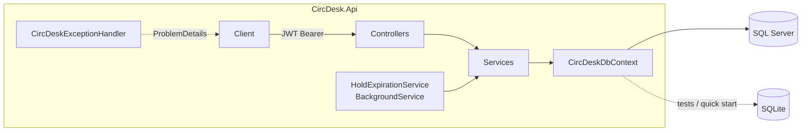

# CircDesk API

> A library circulation REST API — catalog, loans, renewals, FIFO holds and late fines — built to stay correct under concurrent requests.

[](https://github.com/edu-tech220/circdesk-api/actions/workflows/ci.yml)


---

## 📖 Overview

A library needs more than a CRUD of books. It has to decide, with clear rules, **who may take a copy home**, **what happens when no copies are left**, **how a book is shared among several members waiting for it**, and **what the consequence of returning it late is**. CircDesk models that end-to-end *circulation desk* workflow:

- **Catalog** — books with N physical copies (`Copy`), each with its own status (`Available`, `OnLoan`, `Reserved`, `Lost`).
- **Loans** — a member borrows a book; the system assigns an available copy, computes the due date and enforces how many active loans a member may hold at once.
- **Renewals** — limited per loan, and blocked if the loan is already overdue or if another member is waiting for the book.
- **Holds** — when no copies are available, the member joins a FIFO queue. When a copy is returned it is automatically reserved for the first person in line, who gets a pickup window before the turn passes to the next member.
- **Fines** — returning late generates a per-day fine (capped per loan). Members whose outstanding fines exceed a threshold cannot borrow until they pay.

All of this runs under concurrency: two members can try to take the last copy at the same time, and **exactly one must win**.

## ✅ Business rules

| Rule | Default (`appsettings.json` → `Circulation`) |
|---|---|
| Loan period | 14 days (`LoanPeriodDays`) |
| Renewal extension | 7 days (`RenewalExtensionDays`) |
| Max renewals per loan | 1 (`MaxRenewalsPerLoan`) |
| Max simultaneous active loans per member | 5 (`MaxActiveLoansPerMember`) |
| Hold pickup window | 48 hours (`HoldExpirationHours`) |
| Late fine per day | 1.00 (`FinePerDayLate`) |
| Max fine per loan | 20.00 (`MaxFinePerLoan`) |
| Outstanding fines that block new loans | 50.00 (`OutstandingFineBlockThreshold`) |

Additionally:

- A member cannot borrow the same book twice while a previous loan of it is still active.
- Renewals are rejected when the loan is overdue or when other members are queued for that book.
- Holds can only be placed when **no** copies are available — otherwise the member should just borrow it.
- Returning a copy automatically promotes the oldest hold in the queue; if nobody is waiting, the copy becomes available again.
- `Ready` holds expire after the pickup window and the copy cascades to the next member in line.
- Owner-only actions (renew, cancel hold, pay fine) are also allowed for librarians.

## 🏗️ Architecture

Two-project solution — a single ASP.NET Core 8 Web API (controllers + services) and an integration test project.



Inside `CircDesk.Api`:

- **Domain** — plain EF Core entities (`Book`, `Copy`, `Member`, `Loan`, `Hold`, `Fine`) and enums. `LoanStatus` only persists `Active` / `Returned`; *overdue* is derived by comparing `DueDate` with the current time when responding.
- **Data** — `CircDeskDbContext` with Fluent API configuration (indexes, relationships, decimal precision) and the concurrency-token logic described below.
- **Services** — the real business logic lives here, not in the controllers.
  - `LoanService.BorrowAsync` checks blocks, outstanding fines and active-loan limits, then claims a copy inside a retry loop that handles optimistic concurrency conflicts (`DbUpdateConcurrencyException`). If two members race for the same copy, the loser retries with the next available copy (up to 5 attempts) or gets a `409 Conflict` when none are left.
  - `HoldService` manages the per-book hold queue and exposes `ReleaseCopyAsync`, shared by returns, hold expiration and hold cancellation so the "who gets the next copy" logic exists in one place.
  - `FineService` lists and pays fines.
- **BackgroundServices** — `HoldExpirationService` polls every 5 minutes, expires `Ready` holds past their pickup window and advances the queue. It is disabled in the `Testing` environment so tests drive expiration deterministically via `IHoldService.ExpireDueHoldsAsync`.
- **Auth** — JWT Bearer with role claims (`Member`, `Librarian`); passwords hashed with salted PBKDF2-SHA256 (100,000 iterations) and verified with constant-time comparison.
- **Common** — `DomainException` and its subclasses (`NotFoundException`, `ConflictException`, `ForbiddenException`, `ValidationException`, `InvalidCredentialsException`) are translated into RFC 7807 `ProblemDetails` by `CircDeskExceptionHandler` (ASP.NET Core 8 `IExceptionHandler`), so controllers have no repeated `try/catch` blocks.

## 🧠 Technical decisions

- **Portable optimistic concurrency** — instead of a SQL Server `rowversion` column (which SQLite does not have), concurrency control is implemented in code: entities implement `IHasRowVersion`, the property is marked with `IsConcurrencyToken()`, and the `DbContext` assigns a fresh token (`Guid.NewGuid().ToByteArray()`) to every modified entity on `SaveChanges`. Same behavior on both engines, so race-condition tests run without SQL Server.
- **No background job for "overdue"** — there is no persisted `Overdue` status; it is computed on the fly from `DueDate` vs. `DateTime.UtcNow`. Less state to keep in sync.
- **Fines summed in memory** — SQLite cannot translate `SUM()` over `decimal` in LINQ. Outstanding amounts are fetched with `.Select(...).ToListAsync()` and summed client-side; the set is small (fines per member) and the code is identical across providers.
- **Rate limiting on auth only** — `/api/auth/*` uses a `FixedWindowLimiter` (50 requests/minute, returns `429`) to mitigate brute force on login/registration without affecting the rest of the API.
- **Lazily-resolved JWT options** — `JwtBearerOptions` is configured via `AddOptions<JwtBearerOptions>().Configure<IOptions<JwtOptions>>(...)` instead of reading `IConfiguration` once at startup, so configuration overrides applied later (e.g. by `WebApplicationFactory` in tests) are honored.
- **Automatic migrations** — on startup (outside `Testing`) the API applies pending EF Core migrations to the configured database.

## 🧰 Tech stack

| Area | Technology |
|---|---|
| Runtime / framework | .NET 8, ASP.NET Core 8 (controllers) |
| Persistence | Entity Framework Core 8 — SQL Server (default), SQLite (tests / optional local mode) |
| Auth | JWT Bearer, PBKDF2 password hashing |
| Resilience / security | ASP.NET Core rate limiting, RFC 7807 ProblemDetails |
| Background work | `BackgroundService` (hold expiration) |
| API docs | Swashbuckle / Swagger UI (Development) |
| Testing | xUnit, `WebApplicationFactory`, in-memory SQLite |
| DevOps | Docker, Docker Compose, GitHub Actions |

## 🚀 Getting started

### With Docker (API + SQL Server)

```bash
docker compose up --build
```

- API: `http://localhost:8080` (SQL Server 2022 exposed on `1433`).
- The compose file runs the API in `Production`, so Swagger is **not** enabled there — use `curl` / Postman against `http://localhost:8080/api/...`.

### Locally with the .NET SDK

Requires a reachable SQL Server instance (connection string in `src/CircDesk.Api/appsettings.json` → `ConnectionStrings:DefaultConnection`). For a quick try without installing anything, set `"UseSqlite": true` and point the connection string to a SQLite file (e.g. `Data Source=circdesk.db`).

```bash
cd src/CircDesk.Api
dotnet run
```

With the default `http` launch profile the API listens on `http://localhost:5086` and Swagger UI is available at `http://localhost:5086/swagger`.

> **Note:** `POST /api/auth/register` always creates a `Member`. There is no seeded librarian account, so librarian-only endpoints require promoting a user to `Role = 1` (`Librarian`) in the database.

### Creating a new migration

The repo includes a local tool manifest (`.config/dotnet-tools.json`) with `dotnet-ef`:

```bash
dotnet tool restore
cd src/CircDesk.Api
dotnet ef migrations add <MigrationName> -o Migrations
```

## 🧪 Running tests

```bash
dotnet test
```

**35 integration tests** (xUnit). No SQL Server or Docker required: each test class boots the API in memory with `WebApplicationFactory<Program>` against a shared-cache in-memory SQLite database, using one connection per `DbContext` like production so concurrency tests trigger a real race.

| Test class | Tests | Covers |
|---|---:|---|
| `LoanFlowTests` | 13 | Borrow, return, renew, limits, late fines |
| `BooksTests` | 6 | Creating books/copies, search, paging, role permissions |
| `AuthTests` | 5 | Registration, login, protected routes |
| `HoldsTests` | 5 | FIFO queue, auto-promotion on return, expiration and cascade |
| `FinesTests` | 4 | Paying fines, ownership checks, outstanding-fine borrow block |
| `ConcurrencyTests` | 1 | Two members racing for the last copy |
| `RateLimitingTests` | 1 | `429` on auth endpoints |

The same command runs in CI (GitHub Actions, `.github/workflows/ci.yml`) on every push and pull request to `main`.

## 📡 API endpoints

| Method | Route | Access | Description |
|---|---|---|---|
| POST | `/api/auth/register` | Public (rate-limited) | Register a new member |
| POST | `/api/auth/login` | Public (rate-limited) | Log in and receive a JWT |
| GET | `/api/books` | Authenticated | Paged catalog with title/author search |
| GET | `/api/books/{id}` | Authenticated | Book details |
| POST | `/api/books` | Librarian | Create a book with N initial copies |
| POST | `/api/books/{id}/copies` | Librarian | Add a copy to an existing book |
| POST | `/api/loans` | Authenticated | Borrow a book |
| POST | `/api/loans/{id}/return` | Librarian | Register a return |
| POST | `/api/loans/{id}/renew` | Owner or librarian | Renew a loan |
| GET | `/api/loans/mine` | Authenticated | My loans (paged) |
| GET | `/api/loans?memberId=&overdueOnly=` | Librarian | All loans, filterable by member / overdue |
| POST | `/api/holds` | Authenticated | Place a hold |
| DELETE | `/api/holds/{id}` | Owner or librarian | Cancel a hold |
| GET | `/api/holds/mine` | Authenticated | My holds (paged) |
| GET | `/api/fines/mine` | Authenticated | My fines (paged) |
| POST | `/api/fines/{id}/pay` | Owner or librarian | Pay a fine |

Errors are returned as `application/problem+json` (RFC 7807).

## 🗂️ Domain model

| Entity | Role |
|---|---|
| `Book` | Title, author, ISBN; groups N `Copy` records |
| `Copy` | Physical copy with status and concurrency token |
| `Member` | Member or librarian, with credentials and role |
| `Loan` | Loan of a `Copy` to a `Member`, with dates and renewal count |
| `Hold` | Queued reservation for a `Book`: `Queued` → `Ready` → `Fulfilled` / `Expired` |
| `Fine` | Fine linked to an overdue `Loan`, `Pending` / `Paid` |

## 📁 Project structure

```
circdesk-api/
├── .github/workflows/ci.yml        # Build + test on push / PR
├── docker-compose.yml              # API + SQL Server 2022
├── Dockerfile
├── CircDesk.sln
├── src/CircDesk.Api/
│   ├── Auth/                       # JWT token service, PBKDF2 password hasher
│   ├── BackgroundServices/         # HoldExpirationService
│   ├── Common/                     # Exceptions, ProblemDetails handler, options, paging
│   ├── Controllers/                # Auth, Books, Loans, Holds, Fines
│   ├── Data/                       # CircDeskDbContext (Fluent API, concurrency tokens)
│   ├── Domain/                     # Entities and enums
│   ├── Dtos/                       # Request / response contracts
│   ├── Migrations/                 # EF Core migrations
│   ├── Services/                   # Business logic (loans, holds, fines, books)
│   └── Program.cs
└── tests/CircDesk.Api.Tests/
    ├── Infrastructure/             # WebApplicationFactory, auth & data helpers
    └── *Tests.cs                   # Integration tests
```
